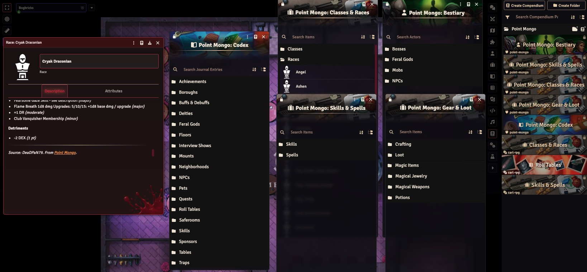

# Point Mongo Codex

Community mobs, bosses, skills, spells, races, classes and gear from the
[Point Mongo](https://pointmongo.com) codex, as Foundry VTT compendiums for the
Dungeon Crawler Carl RPG system (`carl-rpg`). Every entry credits its creator and
links back to the original.



## Install

In Foundry, go to **Add-on Modules → Install Module** and paste this manifest URL:

```console
https://github.com/Achoobert/foundryvtt-point-mongo/releases/latest/download/module.json
```

Then enable **Point Mongo Codex** in a `carl-rpg` world.

## What's inside

| Pack                         | Type    | Contents                                      |
| ---------------------------- | ------- | --------------------------------------------- |
| Point Mongo: Bestiary        | Actor   | Bosses, feral gods, mobs, NPCs                |
| Point Mongo: Skills & Spells | Item    | Skills, spells                                |
| Point Mongo: Classes & Races | Item    | Classes, races                                |
| Point Mongo: Gear & Loot     | Item    | Crafting, loot, magic items, jewelry, potions |
| Point Mongo: Codex           | Journal | Everything else from the codex                |


## Development

```bash
npm ci
npm run pull          # fetch raw codex data into data/raw/
npm run convert       # data/raw -> src/packs/*.yml
npm run build:packs   # src/packs -> packs/ (LevelDB)
npm run dev           # build + sync into your Foundry user data folder
```

Copy `fvtt.config.example.js` to `fvtt.config.js` and fill in your paths before
`npm run dev`.

Every push to `main` publishes a rolling `latest` release (see
`.github/workflows/release.yml`).

`.github/workflows/sync.yml` pulls the codex daily, commits any changes to
`src/packs`, and triggers a release. It needs a `PM_API_KEY` secret in the `api_update` environment.
